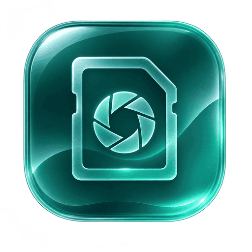

# RAW Importer

<p align="center">
	
</p>

A desktop app for copying camera RAW and image files into organised, date-based folders. RAW Importer never modifies the source files.

## Install

Choose the instructions for your operating system. All downloads are on the [latest release page](https://github.com/Leon83858/RAW_Importer/releases/latest).

### macOS 11 or later (Apple Silicon)

**Install with Homebrew**

```sh
brew tap Leon83858/homebrew-raw-importer
brew trust --cask leon83858/raw-importer/raw-importer
brew install --cask raw-importer
```

`brew trust` approves the Homebrew cask definition; it does not approve the app in macOS. To install manually, download the [DMG](https://github.com/Leon83858/RAW_Importer/releases/latest/download/RAW.Importer_3.0.0_Mac.dmg), open it, then drag **RAW Importer** to **Applications**.

The app is unsigned and not notarized, so macOS may block its first launch. If you trust the download, open **Applications**, Control-click **RAW Importer**, and choose **Open**. If it is still blocked, go to **System Settings > Privacy & Security** and choose **Open Anyway** for RAW Importer. You should not need to run `sudo xattr` commands.

### Windows 10/11 (x64)

1. Download and open the [Windows installer](https://github.com/Leon83858/RAW_Importer/releases/latest/download/RAW.Importer_3.0.0_windows_x64-setup.exe).
2. Follow the installer prompts. It installs for your user account and does not require administrator access.
3. If SmartScreen appears, select **More info**, then **Run anyway** only if you trust the download.

### Debian/Ubuntu (x86_64)

Download the package and checksum, verify the download, then install it:

```sh
curl -fLO https://github.com/Leon83858/RAW_Importer/releases/latest/download/raw-importer_3.0.0_amd64.deb
curl -fLO https://github.com/Leon83858/RAW_Importer/releases/latest/download/raw-importer_3.0.0_amd64.deb.sha256
sha256sum -c raw-importer_3.0.0_amd64.deb.sha256
sudo apt install ./raw-importer_3.0.0_amd64.deb
```

This installs the downloaded package and its dependencies; no apt repository is configured. The package is unsigned and is distributed with a SHA-256 checksum.

### Arch Linux (x86_64)

Download the package and checksum, verify the download, then install it:

```sh
curl -fLO https://github.com/Leon83858/RAW_Importer/releases/latest/download/raw-importer-3.0.0-1-x86_64.pkg.tar.zst
curl -fLO https://github.com/Leon83858/RAW_Importer/releases/latest/download/raw-importer-3.0.0-1-x86_64.pkg.tar.zst.sha256
sha256sum -c raw-importer-3.0.0-1-x86_64.pkg.tar.zst.sha256
sudo pacman -U ./raw-importer-3.0.0-1-x86_64.pkg.tar.zst
```

This installs the downloaded local package; no pacman repository is configured. The package is unsigned and is distributed with a SHA-256 checksum.

### Other Linux distributions (x86_64)

1. Download and extract the [Linux ZIP](https://github.com/Leon83858/RAW_Importer/releases/latest/download/RAW-Importer_3.0.0_linux_x86_64.zip).
2. Install WebKitGTK 4.1 and GTK 3 using your distribution's package manager. For Debian/Ubuntu, install `libwebkit2gtk-4.1-0` and `libgtk-3-0`.
3. In a terminal, change to the extracted folder and run:

   ```sh
   ./install.sh
   ```

This installs the app for your user account without requiring `sudo`. To install for all users instead, run `sudo ./install.sh --system`.

<!-- Screenshot placeholder: Main import screen. Replace this comment with a rendered screenshot when one is available. -->

## First import

1. Select the source folder, such as a camera card, and a destination folder.
2. Choose the file types and folder layout. Add custom file extensions when needed.
3. Scan the source and review the preview before starting the import.
4. Start the import. The source files remain unchanged.

<!-- Screenshot placeholder: Import preview. Keep this as an HTML comment until a real screenshot is added. -->

## Features

- Organise imports by year, month and day, with optional source subfolders or file-type folders.
- Use EXIF capture dates or filesystem modification dates for folder naming.
- Select common RAW and image formats, or add custom file extensions.
- Skip or rename name conflicts; optionally skip files verified to have identical content.
- Keep local import history and recover recoverable session state.
- Use English, German, French, Dutch or Belgian Dutch, with light, dark or system appearance.
- Open Settings from the menu or with `Cmd+,` on macOS.
- Check GitHub for updates manually or opt in to a startup check. Updates are never downloaded or installed automatically.

Built-in extensions include ARW, CR2, CR3, NEF, RAF, ORF, RW2, DNG, JPG, JPEG, PNG, TIFF/TIF and HEIC/HEIF.

## License

RAW Importer is distributed under the GNU General Public License v3.0 only. See [LICENSE](LICENSE).
